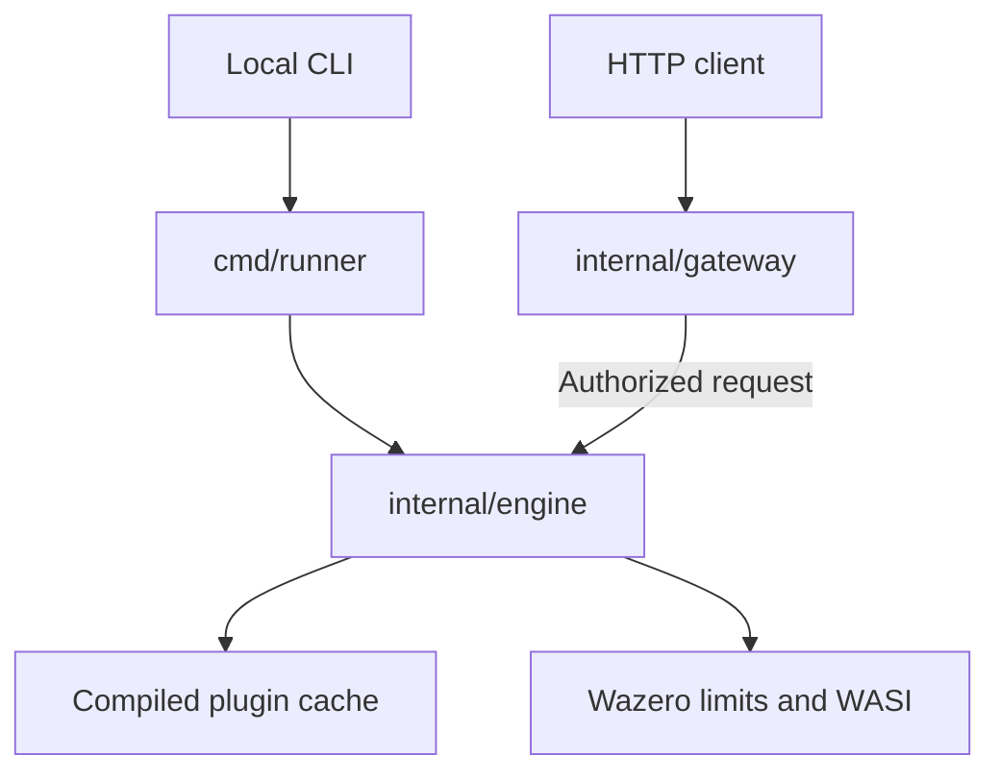

<div align="center">
  <h1>Go Wasm Runner</h1>
  <p>An ultra-lightweight serverless execution environment and gateway for WebAssembly modules, written 100% in Go.</p>

  

  <br>

  
  [](https://www.codefactor.io/repository/github/enoquesousa/gowasmrunner)
  [](https://pkg.go.dev/github.com/enoquesousa/gowasmrunner)
  
  
  
</div>

---

`gowasmrunner` is an isolated execution environment that allows you to run WebAssembly functions locally via the CLI or expose them instantly as a serverless HTTP API. It solves portability and security issues when running third-party code by enforcing strict memory and execution time boundaries, without relying on CGO dependencies.

## Demonstration

Running a plugin via CLI:
```bash
$ gowasmrunner -mode plugin plugin-add.wasm add 10 20
Plugin plugin-add.wasm [add] result: [30]
```

Running as a Serverless Gateway:
```bash
$ gowasmrunner -mode server -port 8080
# Listens on 127.0.0.1:8080 by default.

# In another terminal window:
$ curl --fail-with-body "http://127.0.0.1:8080/execute/plugin-greet.wasm?func=greet" -d "World"
Hello, World
```

This example is an unauthenticated local development mode. Other local processes
can invoke its plugins. A non-loopback listener requires an API token and TLS;
see [Authentication and request flow](#authentication-and-request-flow).


## Technologies & Frameworks

<div align="center">
  
  
  
  
  
</div>

## Prerequisites

- Go >= 1.26.10
- Docker (optional, for running as a container)

## Installation and Usage

### As a binary

```bash
go install github.com/enoquesousa/gowasmrunner/cmd/runner@latest
```

### From source

```bash
git clone https://github.com/enoquesousa/gowasmrunner.git
cd gowasmrunner
make build
make run
```

### With Docker

```bash
./scripts/generate-dev-tls.sh
export GOWASMRUNNER_API_TOKEN="$(openssl rand -hex 32)"
docker build -t gowasmrunner .
docker run --rm -p 127.0.0.1:8080:8080 \
  --env GOWASMRUNNER_API_TOKEN \
  --mount "type=bind,src=$PWD/certs/dev/server.crt,dst=/certs/server.crt,readonly" \
  --mount "type=bind,src=$PWD/certs/dev/server.key,dst=/certs/server.key,readonly" \
  gowasmrunner
```

The container binds internally to `0.0.0.0:8080` and requires the token and TLS
files; it fails closed if those credentials are missing. The example publishes
the port only on the host's loopback interface. Only the server certificate/key
are mounted: the CA private key is not part of the container or image.

Use the generated public CA to verify the server. This example supplies the
Authorization header over stdin instead of expanding the token in curl's
command-line arguments:

```bash
printf 'Authorization: Bearer %s\n' "$GOWASMRUNNER_API_TOKEN" |
  curl --fail-with-body --cacert certs/dev/ca.crt --header @- \
    --data 'World' \
    'https://127.0.0.1:8080/execute/plugin-greet.wasm?func=greet'
```

The script needs OpenSSL. It creates fresh seven-day development certificates
under `certs/dev/`, uses owner-only permissions and refuses to overwrite an
existing directory. The server SANs cover `localhost`, `127.0.0.1` and `::1`.
For a remote deployment, use a certificate valid for the actual hostname/IP
clients will connect to. Do not disable certificate verification. Generated
certificates, private keys and local environment files are excluded from Git
and the Docker build context.

## Makefile Targets

| Target | Description |
|---|---|
| `build` | Compiles the CLI binary into the `bin/` folder |
| `test` | Runs all integration and unit tests |
| `gen-example` | Generates example `.wasm` modules in the `examples/` folder |
| `run` | Builds, generates examples, and executes a simple addition test |
| `clean` | Removes build artifacts and temporary compiled modules |

## Architecture

The project follows a modular architecture focused on isolation between the host runtime and guest modules.

<div align="center">



</div>

- `cmd/runner`: Entry point that manages the CLI and the HTTP Server.
- `internal/gateway`: Listener policy, TLS, API-token checks and bounded HTTP requests.
- `internal/engine`: The core system. Manages the `wazero` lifecycle, resource limits (memory/timeout), WASI integration, and the compiled modules cache (`PluginStore`).
- `plugins/`: Default directory scanned by the system for module pre-warming.

See [docs/architecture.md](docs/architecture.md) for more details on technical decisions.

## Authentication and request flow

The HTTP gateway has two modes. With no `GOWASMRUNNER_API_TOKEN` variable, it
accepts only a literal loopback listener and applies local Host and browser
cross-origin checks. This is a local development convenience, not authentication
of other processes on the machine. With the variable present, its value must be
32–4096 characters from the Bearer token alphabet (letters, digits and
`-._~+/=`), without whitespace; an empty value is an error. The random hexadecimal
token in the Docker example satisfies this format.

A configured token is required on every execution request, including loopback
requests. Clients send it only as `Authorization: Bearer ...`. Query-string
credentials, cookies and command-line token flags are not authentication
mechanisms. Multiple Authorization headers are rejected. Authorization completes
before the gateway reads the request body or invokes a plugin.

The listener and certificate configuration are checked before plugins are
loaded. A wildcard, DNS or remote listener requires both the token and TLS
certificate/private-key files. A remote HTTP request cannot claim HTTPS by
setting `X-Forwarded-Proto`. To terminate TLS in a reverse proxy, keep the runner
bound to loopback, configure the token, and forward the Authorization header
over that local connection. A proxy on another machine must use TLS to reach
the runner.

An accepted request follows this flow:

1. The gateway checks the actual transport and the configured credential policy.
2. It accepts `POST /execute/{plugin}` and reads at most **1 MiB** of body data.
3. It resolves a module already loaded from the operator's plugin directory.
4. The engine instantiates the module, validates the string ABI, and copies only
   the request body into guest memory.
5. The guest function runs with the configured execution deadline and memory
   limit. The gateway returns its output, or a generic error without exposing
   internal engine details. Responses use `Cache-Control: no-store`.

The shared token grants access to all cached plugins/functions. There are no
user accounts, JWTs, refresh tokens, per-plugin roles or individual revocation.
The gateway reads the environment once at startup and compares fixed-length
token digests in constant time. It does not put the token in the request payload,
guest environment, URL or application logs. Rotate it through the deployment
environment and restart the process; all clients sharing it must be updated.
TLS keys are unencrypted PEM files loaded at startup and must be protected with
filesystem permissions. There is no automatic credential reload.

The CLI modes use local operating-system permissions and do not require the HTTP
token. Guest modules do not inherit host environment variables, filesystem
mounts or sockets. They do receive the payload supplied to them and can write to
the configured stdout/stderr bridge. Plugin files are loaded at startup; there
is no automatic hot reload. See [SECURITY.md](SECURITY.md) for the boundaries.

## API Reference

### Execute Plugin

`POST /execute/{plugin_name}`

Executes an exported function from a cached Wasm module.

**Query Parameters:**
- `func` (optional): Name of the function to execute. Default: `greet`.

**Body:**
Raw payload (text/plain, application/json, etc) that will be passed to the Wasm
module's linear memory. The HTTP body limit is 1 MiB; a guest may reject smaller
inputs if its allocation/output exceeds its own memory limit.

**Authentication:**
Send the configured token in a single Authorization Bearer header. Missing or
invalid credentials are rejected before execution; requests larger than the
body limit receive HTTP 413. The token is never accepted from a URL or cookie.

**Response:**
The result returned by the Wasm function, text-encoded in the response body.

## Configuration

Current configurations are managed via command line flags:

| Flag | Description | Type | Default |
|---|---|---|---|
| `-mode` | Operation mode (`numeric`, `string`, `plugin`, `server`) | string | `numeric` |
| `-wasm` | Direct path to a Wasm file (num/str modes) | string | `""` |
| `-plugins` | Directory to load cached plugins from | string | `./plugins` |
| `-func` | Default function to be executed | string | `add` |
| `-port` | Port for the HTTP server | string | `8080` |
| `-host` | HTTP listen host; literal loopback required without a token | string | `127.0.0.1` |
| `-tls-cert` | PEM server certificate/chain for HTTPS | string | `""` |
| `-tls-key` | Unencrypted PEM private key matching the certificate | string | `""` |

`GOWASMRUNNER_API_TOKEN` is read only for server mode. It has no command-line
equivalent and is not needed for local CLI execution.

## Roadmap (Implemented Phases)

- [x] **Phase 1: The Host (Basic Wasm Runtime)**
  - **Objective:** Configure the runtime and execute a simple arithmetic function compiled in Wasm.
  - **What was done:** Utilized the Wazero library (100% Go, no CGO dependency) to load a `.wasm` file and call an exported function via command line arguments.

- [x] **Phase 2: The Bridge (Memory and Data Exchange)**
  - **Objective:** Overcome Wasm's limitation of only handling numbers by enabling the passing of strings and complex objects.
  - **What was done:** Implemented memory allocation logic in the guest (Wasm) and buffer read/write operations in the host (Go) to pass and return greeting strings.

- [x] **Phase 3: The Warden (Sandboxing and Resources)**
  - **Objective:** Ensure the Wasm module does not consume all server resources, which is essential for the serverless model.
  - **What was done:** Configured memory limits (`MaxMemoryPages`) and deadlines
    with `context.WithTimeout` plus `WithCloseOnContextDone(true)`, so cancellation
    actually interrupts guest execution. WASI uses the configured stdout/stderr bridge.

- [x] **Phase 4: The Registry (Dynamic Plugin System)**
  - **Objective:** Transform the executor into a platform that loads and manages multiple modules "on-the-fly".
  - **What was done:** Created a plugin cache that scans the configured directory
    at startup, pre-compiles modules (`CompiledModule`), and reuses them for CLI or
    HTTP invocations. It does not monitor later filesystem changes.

- [x] **Phase 5: The Gateway (Serverless HTTP Interface)**
  - **Objective:** Expose Wasm modules through an HTTP API, simulating the behavior of AWS Lambda or Cloudflare Workers.
  - **What was done:** Developed an HTTP server (port 8080) where the `/execute/{plugin_name}` path routes the request (POST body) to the respective Wasm plugin. Included a lean `Dockerfile` (Alpine) ready for deployment.

- [x] **The Cherry on Top (Language Agnosticism)**
  - The environment proves to be language-agnostic, allowing functions written in languages like **Rust** or **TinyGo** to be easily compiled to `.wasm` and placed in the examples/plugins folder for identical execution.

## Contributing

Check our [CONTRIBUTING.md](CONTRIBUTING.md) to learn how to set up your environment, run tests, and submit Pull Requests.

## License

Distributed under the MIT License. See [LICENSE](LICENSE) for more information.

<div align="center">

## Author

**Enoque Sousa**

[](https://www.linkedin.com/in/enoque-sousa-bb89aa168/)
[](https://github.com/enoquesousa)
[](https://enoquesousa.vercel.app)

**[⬆ Back to Top](#go-wasm-runner)**

Made with ❤️ by [Enoque Sousa](https://github.com/enoquesousa)

**Project Status:** Archived — Study Project

</div>
